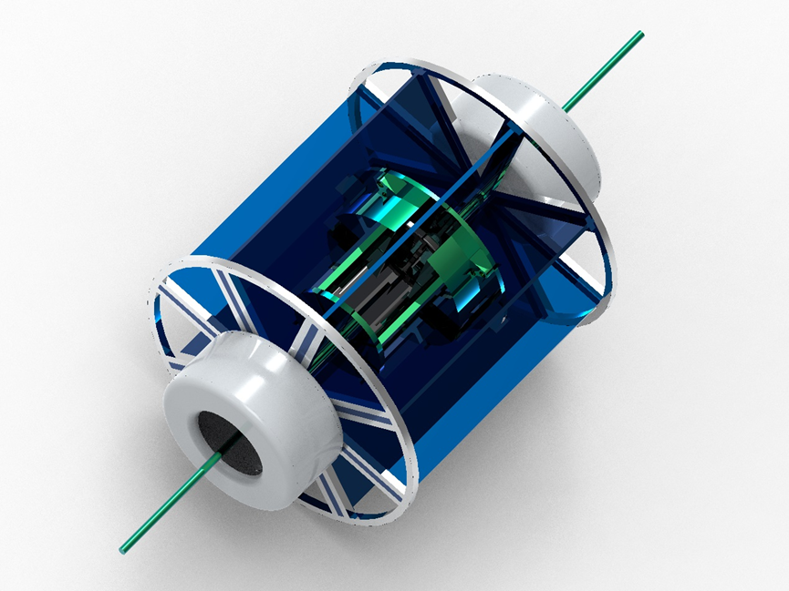

# 仿生风滚草

> 基于风滚草仿生的荒漠化防治移动机器人设计 —— 仿生学课程大作业

## 目录结构
- `Body/` -存放主要内容
- `Note`  -存放零时想法

## 使用方法（包括INDEX）
### 效果图

*仿生风滚草 - 实物渲染效果*

### 项目简介
本项目针对全球日益严重的**荒漠化问题**，提出一款仿生风滚草的荒漠治理机器人。通过模仿风滚草的滚动传播机制，设计一种能够在荒漠环境中自主移动、播撒种子并进行初步养护的仿生机器人，为荒漠生态修复提供一种低成本、高效率的解决方案。 

### 项目亮点
- **仿生对象**：风滚草（滚动的种子传播方式）
- **核心功能**：自主滚动移动 + 种子播撒 + 初步固沙
- **应用场景**：荒漠化严重地区、生态修复工程
- **优势**：结构简单、成本较低、适应恶劣环境能力强

### 使用方法
1. 阅读 `仿生大作业.docx` 获取完整设计思路
2. 查看 `Body` 文件夹中的图片和模型了解结构细节
3. 可作为仿生设计、荒漠治理、机器人课程的参考案例

### 总结与展望
该设计通过仿生学原理，将自然界风滚草的生存策略转化为工程方案，为荒漠化治理提供了新思路。未来可进一步结合无人机协同、智能控制等技术，提升播种精度与环境适应性。

## 保留内容

### logo与作者

- 作者：pinavia
- 

### 学习许可与权利保留

- 本项目允许个人、学校和研究者进行非商业性的学习、研究和引用。
- 未经著作权人书面许可，不得将项目内容用于商业开发、产品制造、商业服务、商业宣传、投标交付、毕业设计成品交付或再授权。
- 不得删除作者、来源、版本历史和第三方许可证声明，不得将本项目或其衍生成果宣称为与作者无关的原创项目。
- 软件源码适用 [PolyForm Noncommercial 1.0.0](https://polyformproject.org/licenses/noncommercial/1.0.0/)；机械模型、PCB、原理图、图片、文档、Unity 工程和其他非软件资料适用 [CC BY-NC-ND 4.0](https://creativecommons.org/licenses/by-nc-nd/4.0/)。
- SE、SW、STEP/STP 及其他三维模型仅允许个人或学校进行非商业学习、评审和研究；未经著作权人书面许可，不得用于加工、打样、制造、销售、量产、投标、产品交付、商业宣传、改作或再授权。
- 第三方组件、模板、元件库、外购件模型和工具仍受其原始许可证约束；本声明不扩大作者对第三方内容的权利。

商业使用、产品化、公司内部长期使用、转让或排他性授权需另行取得著作权人的书面许可。
